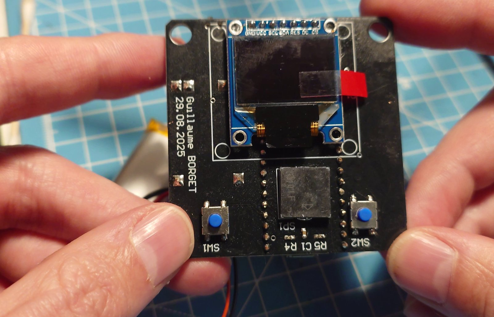
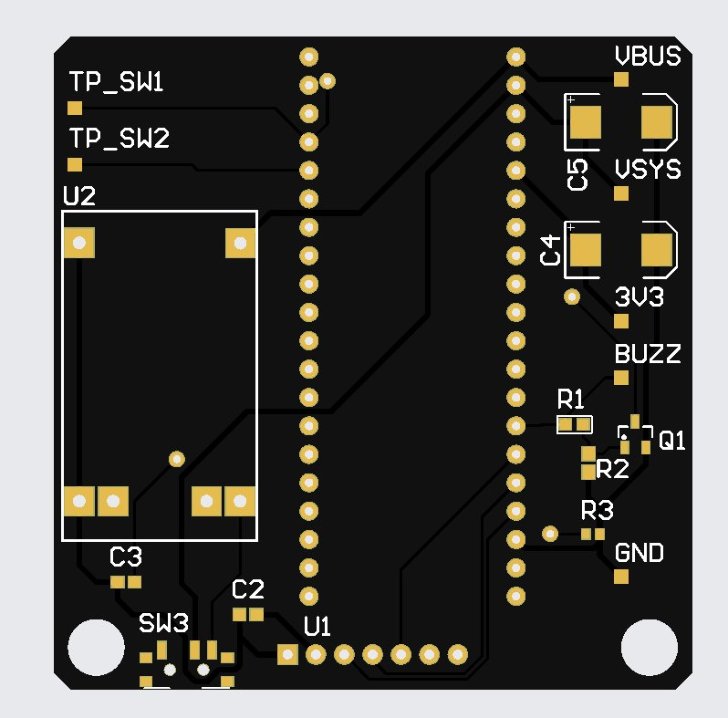
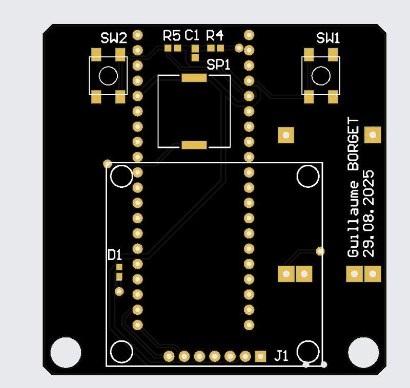

# Pico Pong

Handheld Pong console built around a Raspberry Pi Pico: my own 2-layer PCB, Li-ion battery with USB charging, a small colour OLED, two buttons and a piezo buzzer.

I did the whole chain myself: component selection, schematic and layout in Altium CircuitMaker, ordering the boards at JLCPCB, soldering, and the firmware in C with the Pico SDK.



More photos and videos of the build on the [project page](https://guillaumeborget.github.io/pico-pong.html).

## Hardware

| Block | Part |
| --- | --- |
| MCU | Raspberry Pi Pico (RP2040), soldered on the board |
| Display | 0.95" SSD1331 OLED, 96x64 RGB, SPI |
| Inputs | 2x 6x6 tact switches, 10k pull-ups |
| Sound | Murata PKLCS1212E4001 piezo (4 kHz) driven by an MMBT3904 NPN |
| Power | 3.7 V Li-ion cell, TP4056 charger module (USB-C), slide switch on VSYS |
| Other | Power LED, test points on VBUS, VSYS, 3V3, BUZZ, both buttons and GND |

Power path: USB 5 V -> TP4056 -> battery -> switch -> VSYS -> Pico regulator -> 3V3.

PCB: 2 layers with a ground pour, 6-8 mil signals, 20 mil power, 10 mil clearance. The TP4056 module had no footprint in the library so I made the symbol and footprint myself.

- Schematic: [hardware/pico-pong-schematic.pdf](hardware/pico-pong-schematic.pdf)
- Gerber files: available on request

| Top | Bottom |
| --- | --- |
|  |  |

### Pinout

| Signal | GPIO |
| --- | --- |
| Left button | 2 |
| Right button | 3 |
| OLED DC | 16 |
| OLED CS | 17 |
| OLED SCK | 18 |
| OLED MOSI | 19 |
| OLED RES | 20 |
| Buzzer | 21 |

## Firmware

`firmware/pong.c`, plain C on the Pico SDK 2.2.0, no external library.

- small SSD1331 driver over SPI at 20 MHz, using the controller's own rectangle and clear commands, so only the ball and paddle are redrawn each frame instead of the whole screen
- buzzer on a PWM slice at 4 kHz (resonant frequency of the piezo)
- single player: the paddle is at the bottom, the ball bounces on the walls and speeds up every 5 points

### Build

With the Raspberry Pi Pico extension for VS Code, open the `firmware` folder and build. Or from a terminal:

```
cmake -S firmware -B build -G Ninja
ninja -C build
```

Then copy `build/pong.uf2` on the Pico in BOOTSEL mode.

## Known limitations / next steps

- no debouncing on the buttons yet (polled every frame)
- the score is counted but not displayed
- sleep mode to save battery

## License

© 2025-2026 Guillaume Borget. All rights reserved, see [LICENSE](LICENSE). The design is shared to show my work, not for reuse or production.
